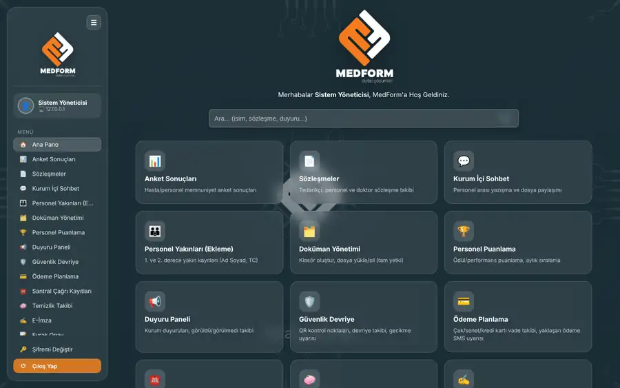
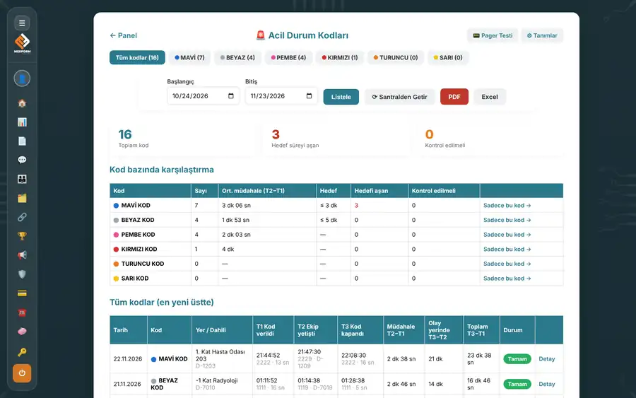
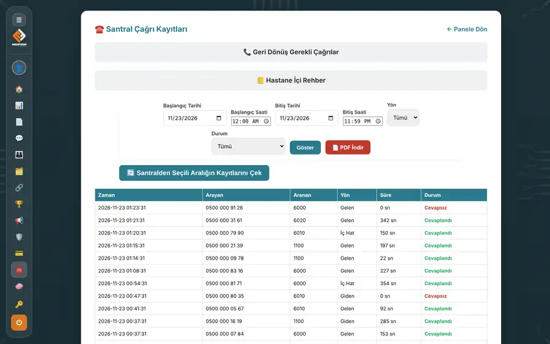
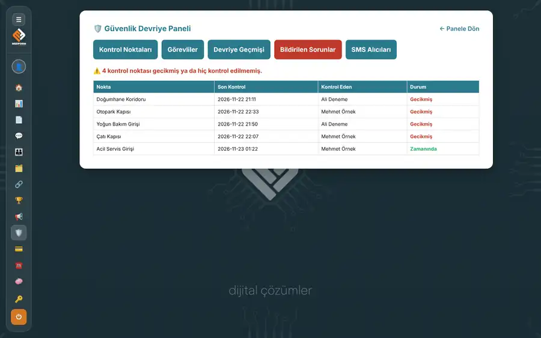

# MEDFORM · Hastane Operasyon Platformu

**🇹🇷 Hastanenin günlük operasyonlarını tek çatı altında toplayan web tabanlı platform.**
**🇬🇧 A web platform that brings a hospital's day-to-day operations under one roof.**

> Geliştirici · Developer: **Mehmet Hakan Karaaslan**
> Kaynak kod kapalıdır; bu depo yalnızca tanıtım amaçlıdır. · *Source code is closed; this repository is for showcase purposes only.*

---

## 🇹🇷 Hakkında

MEDFORM, Python/Flask ile geliştirdiğim ve bir genel hastanede her gün kullanılan modüler bir web uygulamasıdır. Personel tek bir girişle yalnızca yetkili olduğu modülleri görür; her işlem kayıt altına alınır.

## 🇬🇧 About

MEDFORM is a modular web application I designed and built with Python/Flask, used every day in a general hospital. Staff sign in once and see only the modules they are authorized for; every action is logged.

---

## Modüller · Modules

| Alan · Area | Modüller · Modules |
|---|---|
| 📞 **İletişim · Communication** | Santral Çağrı Kayıtları & geri dönüş takibi · Hastane İçi Rehber · Kurum İçi Sohbet · Duyuru Paneli · SMS Bildirimleri |
| 🚨 **Acil Durum & Güvenlik · Emergency & Security** | Acil Durum Kodları (pager entegrasyonlu, müdahale süresi ölçümü) · Güvenlik Devriye (QR kontrol noktaları, gecikme uyarısı) |
| ✅ **Kalite & Operasyon · Quality & Operations** | Temizlik Takibi (QR + fotoğraflı kayıt) · Anket Sonuçları · Personel Puanlama · QR Kod Üretici |
| 📁 **Belge & Onay · Documents & Approvals** | Doküman Yönetimi (KYS) · Evrak Onay Akışı · E-İmza · Sözleşme Takibi |
| 💼 **İdari · Administrative** | Ödeme Planlama (vade takibi, SMS hatırlatma) · Personel Yakınları |
| 🔐 **Altyapı · Platform** | Kullanıcı & modül bazlı yetki yönetimi · Denetim / İşlem Geçmişi · PDF & Excel raporlama |
| 🤖 **Geliştiriliyor · In progress** | MEDFORM Yapay Zeka Asistanı (doğal dille soru-cevap) |

---

## Öne çıkanlar · Highlights

- **Acil durum kodları:** Kodun verilmesi, ekibin yetişmesi ve kodun kapanması santral kayıtlarından otomatik yakalanır; müdahale süreleri hedeflerle karşılaştırılır ve akreditasyon göstergeleri için raporlanır.
  *Emergency codes: call, team-arrival and close times are captured automatically from PBX records and compared against response-time targets for accreditation reporting.*
- **QR ile saha takibi:** Temizlik ve güvenlik personeli kontrol noktalarındaki QR kodu okutarak kayıt düşer; geciken noktalar için sorumlulara SMS gider.
  *QR-based field tracking: cleaning and security staff scan checkpoints; overdue points trigger SMS alerts.*
- **Santral entegrasyonu:** Çağrı kayıtları otomatik aktarılır; ulaşılamayan arayanlar "geri dönüş gerekli" listesinde toplanır.
  *PBX integration: call records sync automatically; missed callers are queued for call-back.*
- **Güvenlik ve KVKK:** Rol bazlı erişim, işlem kaydı, hassas verinin kod deposunun dışında tutulması.
  *Security & privacy: role-based access, audit logging, secrets and patient data kept out of source control.*

---

## Teknolojiler · Tech stack

`Python` `Flask` `Waitress` `SQLite` `SQL Server` `Jinja2` `HTML/CSS` `JavaScript` `ReportLab (PDF)` `Matplotlib` `QR` `SMS API` `PBX CDR API` `Windows Server`

---

## Ekran görüntüleri · Screenshots

*Tüm ekranlar örnek (sahte) verilerle alınmıştır. · All screens use synthetic demo data.*

| Acil Durum Kodları · Emergency Codes | Santral Çağrı Kayıtları · Call Records |
|---|---|
|  |  |

| Güvenlik Devriye · Security Patrol |
|---|
|  |

---

📫 [LinkedIn](https://www.linkedin.com/in/hakan-karaaslan-5ab102278/) · [GitHub](https://github.com/Hknkrsln)

© Mehmet Hakan Karaaslan. Tüm hakları saklıdır. · All rights reserved.
